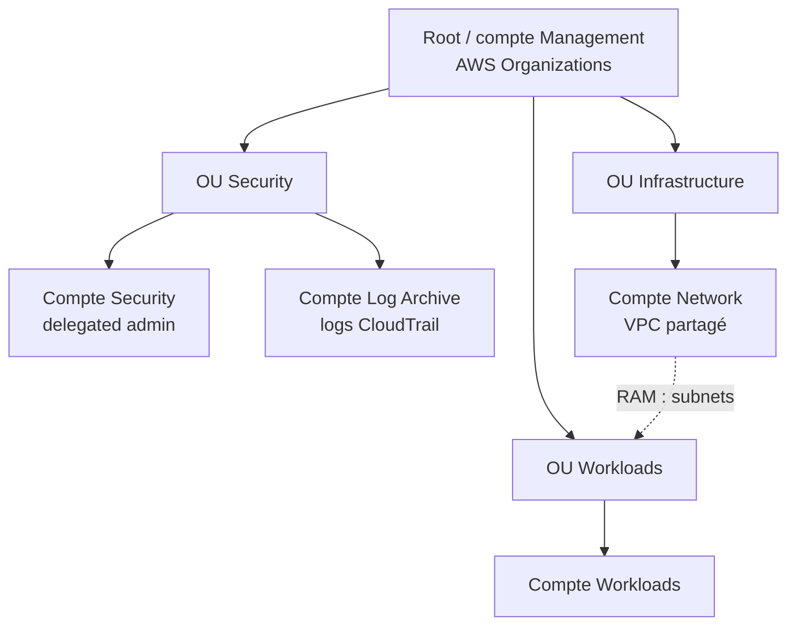

# Landing Zone AWS multi-comptes (Terraform)

Projet perso (lab) : une Landing Zone AWS construite à la main avec Terraform, sans Control Tower, pour comprendre ce qu'il y a sous le capot (gouvernance, sécurité centralisée, réseau partagé).

## Architecture



## Ce qui est en place

- **AWS Organizations** : 3 OU (Security, Workloads, Infrastructure), 4 comptes membres, créés en Terraform.
- **SCP** : protection de CloudTrail et de Security Hub (OU Security), restriction de région eu-west-1 (OU Workloads), interdiction de supprimer un VPC (OU Infrastructure).
- **Sécurité centralisée** : GuardDuty, Security Hub et AWS Config en *delegated admin* sur le compte Security, pour garder le compte Management le plus vierge possible.
- **Logs** : trail CloudTrail d'organisation écrivant dans un bucket S3 du compte Log Archive.
- **Réseau partagé** : VPC et 2 subnets privés (2 zones de disponibilité) dans le compte Network, partagés à l'OU Workloads via AWS RAM.
- **State Terraform** : backend S3 avec verrouillage DynamoDB, un state par dossier.
- **CI** : scan de sécurité tfsec et Checkov à chaque push (non bloquant pour l'instant).

## Structure du repo

```
modules/aws/   modules réutilisables (governance, security, networking, storage...)
live/          une configuration par brique, chacune avec son state
```

## Ordre de déploiement

1. `live/global/bootstrap`
2. `live/global/organizations`
3. `live/log-archive/cloudtrail-bucket`
4. `live/security/guardduty`
5. `live/security/config`
6. `live/network/vpc`
7. `live/network/ram`

Les variables sensibles (e-mails des comptes) sont dans `terraform.tfvars`, ignoré par git. Copier `terraform.tfvars.example` et adapter.

## À venir

- Config Rules au niveau de l'organisation
- IAM Identity Center
- Route 53 centralisé et partage de paramètres via SSM

## Limites

C'est un environnement de test sur mes propres comptes, pas une plateforme de production.
