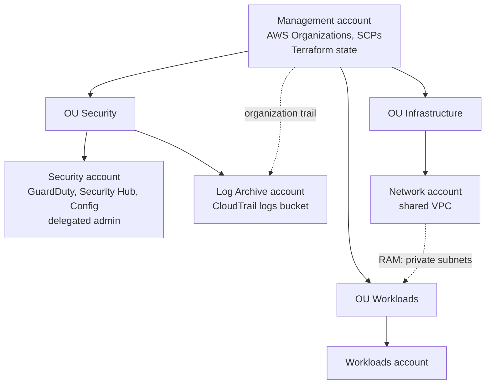

# High-Level Design: AWS Multi-Account Landing Zone

- **Version:** 0.2
- **Date:** 2026-10-04
- **Author:** Jérémie Maumet
- **Status:** Draft

## 1. Context and objectives
Provide a secure, governed AWS multi-account foundation to host workloads. The landing zone separates responsibilities by account (management, security, logging, network, workloads), centralizes security and audit, and is fully defined as code with Terraform.

## 2. Scope
**In scope**
- AWS Organizations structure (OUs, accounts) and SCP guardrails
- Centralized security services (GuardDuty, Security Hub, Config)
- Centralized audit logging (organization CloudTrail)
- Shared network (VPC owned by a Network account, shared via RAM)
- Terraform modules, remote state and locking

**Out of scope**
- Application workloads themselves
- On-premises connectivity (VPN, Direct Connect)
- Multi-region deployment

## 3. Requirements
**Functional**
- Create and organize accounts by function through code.
- Collect all API activity of the organization in one protected location.
- Detect threats and misconfigurations across all accounts from one place.
- Provide workload accounts with a ready-to-use network.

**Non-functional**
- **Security:** no member account can disable security services or audit logging; least privilege; logs protected from deletion.
- **Auditability:** every change goes through code (Terraform plan + Git review).
- **Cost:** minimal fixed cost, suitable for a small organization.
- **Scalability:** structure can grow to more accounts (see ADR-0005).
- **Operability:** manageable by a single administrator.

**Constraints**
- AWS only, single region.
- Terraform as the only infrastructure-as-code tool.

## 4. Architecture overview

- **Management** owns the organization, the guardrails and the Terraform state. No workloads run here.
- **Security OU** groups the accounts that protect and audit the organization.
- **Infrastructure OU** holds shared platform services, starting with the network.
- **Workloads OU** hosts application accounts, which consume the shared network.

## 5. Components
| Component | Role | Interacts with |
|---|---|---|
| Management account | AWS Organizations, SCPs, organization CloudTrail, Terraform state (S3 + DynamoDB lock) | All accounts |
| Security account | Delegated administrator for GuardDuty, Security Hub and Config | All member accounts (findings) |
| Log Archive account | Central S3 bucket for CloudTrail logs | Management (organization trail) |
| Network account | Owns the VPC (2 private subnets), shares subnets via RAM | Workloads OU |
| Workloads account | Runs applications inside the shared subnets | Network account |

## 6. Security
- **Guardrails:** SCPs attached at OU level, managed by a reusable Terraform module.
- **Detection:** GuardDuty, Security Hub and Config administered from the Security account.
- **Audit logging:** organization-wide CloudTrail trail delivered to the Log Archive account; bucket access restricted by bucket policy.
- **Identity and access:** IAM Identity Center planned (ADR-0004); not yet implemented.
- **Encryption:** encryption at rest on the Terraform state and log buckets.

## 7. Network
- One VPC with 2 private subnets, owned by the Network account.
- Subnets shared with the Workloads OU through AWS RAM: every account in the OU can deploy into them, but cannot change subnets, route tables or NACLs.
- Isolation between workloads relies on security groups (see ADR-0002 for trade-offs).

## 8. Operations
- **Deployment:** Terraform, one reusable module per building block (14 modules), `plan` reviewed before every `apply`.
- **State:** remote state on S3 in the Management account, locking with DynamoDB.
- **Monitoring:** security findings aggregated in Security Hub; operational monitoring to be defined per workload.
- **Recovery:** the whole landing zone can be rebuilt from code.

## 9. Key decisions
| ADR | Decision | Status |
|---|---|---|
| [ADR-0001](adr/0001-terraform-over-control-tower.md) | Pure Terraform instead of AWS Control Tower | Accepted |
| [ADR-0002](adr/0002-vpc-sharing-over-transit-gateway.md) | VPC sharing with AWS RAM instead of Transit Gateway | Accepted |
| [ADR-0003](adr/0003-security-and-log-archive-in-one-ou.md) | Security and Log Archive in a single Security OU | Accepted |
| [ADR-0004](adr/0004-iam-identity-center-for-human-access.md) | IAM Identity Center for human access | Proposed |
| [ADR-0005](adr/0005-scaling-to-150-accounts.md) | Scaling the landing zone to ~150 accounts | Proposed |
| - | Route 53: dedicated account or Workloads account | To decide |

## 10. Risks and open points
| Risk / open point | Impact | Mitigation / next step |
|---|---|---|
| No centralized human access yet | Scattered credentials, harder offboarding | Implement IAM Identity Center (ADR-0004) |
| Config recorder enabled but no Config rules | Misconfigurations not evaluated | Add a baseline set of Config rules |
| Single shared VPC | Weak isolation, large blast radius | Accepted at this size; Transit Gateway if segmentation is needed |
| Single region | No regional resilience | Out of scope for now |
| Log bucket deletion protection | Logs could be altered by a privileged user | Add S3 Object Lock and an SCP denying deletion |
